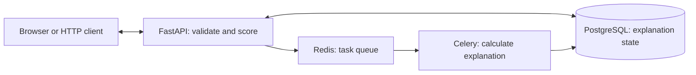

# Fraud Detection

**Score a transaction, get its model probability, and retrieve the worker's saved explanation.**

A FastAPI application with a browser demo, a Celery worker, PostgreSQL, and Redis. It also includes XGBoost training, benchmark experiments, and optional input-drift monitoring.

## What it does

| Need | How it works |
| --- | --- |
| Score a transaction | Accepts 30 ordered numeric features and returns a prediction and class-1 probability. |
| Inspect the result | The browser demo calls the real API and shows the response and explanation status. |
| Explain a prediction | Celery computes the explanation in the background; PostgreSQL keeps its state and result. |
| Train and compare models | Separate pipelines support scaling, SMOTE, optional feature engineering, Optuna tuning, and held-out evaluation. |
| Watch input changes | Trained bundles can supply a reference for KS drift checks, Prometheus metrics, and a local Grafana alert. |

## Architecture



The API returns the prediction after saving a pending record and dispatching the task. The worker saves the explanation; the client retrieves it through the API. API and worker load the same model and preprocessing bundle. A queued task is not a completed explanation.

Training runs separately and writes new bundles without replacing the packaged model. Monitoring is optional and does not block scoring.

## Status

This is a prototype. The [bundled logistic model](models/README.md) has unknown training provenance, calibration, and held-out fraud performance. The [recorded XGBoost benchmarks](#benchmarks) are separate experiments on a historical public dataset; their scores do not describe the bundled model.

## Quick start

Needs Docker with Compose v2 and Python 3 for the HTTP smoke check. The first build downloads images and packages. Run these commands from a fresh checkout:

```sh
git clone https://github.com/wtfashwin/fraud-detection.git
cd fraud-detection
docker compose --env-file .env.example up --build -d --wait
python3 scripts/smoke_test.py
```

Open the [browser demo](http://127.0.0.1:8000/demo/) or [API documentation](http://127.0.0.1:8000/docs). The smoke check submits two concurrent requests with the same synthetic transaction ID, requires one acceptance and one conflict, checks a later duplicate and invalid input, and waits for a completed explanation. The JSON receipt saves both concurrent responses. Success prints `"status": "PASS"`; it establishes observed HTTP outcomes and worker completion, not exactly-once queue delivery or fraud accuracy.

In the demo, choose **Fill synthetic example**, then **Score transaction**. Use **Check explanation** to retrieve the saved result. The synthetic example has no expected fraud outcome.

### Local configuration

[`.env.example`](.env.example) supplies demonstration values directly to Compose; no shell export is needed for the commands above.

| Variable | Purpose |
| --- | --- |
| `POSTGRES_USER`, `POSTGRES_PASSWORD`, `POSTGRES_DB` | Local database credentials and database name. |
| `API_PORT` | Host API port; defaults to `8000`. |
| `FRAUD_IMAGE` | API and worker image; defaults to the locally built `fraud-api:local`. |

Compose connects API and worker to PostgreSQL and Redis internally. The API port binds to loopback. If you change `API_PORT`, use that port in the browser and in the smoke check's `--url` argument.

Check services or stop the stack from the repository root:

```sh
docker compose --env-file .env.example ps
docker compose --env-file .env.example logs --tail 100 api xai-worker
docker compose --env-file .env.example down
```

`down` keeps data volumes. Add `-v` only when you intend to discard local demo records.

## API

Features must be finite numbers in this order: `Time`, `V1` through `V28`, `Amount`. Do not include the `Class` label. `GET /model-info` returns the input order and explanation feature names.

| Route | Result |
| --- | --- |
| `GET /status` | Process liveness. |
| `GET /health` | Process liveness and input-drift status. |
| `GET /ready` | `200` when the model, migrated explanation table, and broker are usable; otherwise `503`. |
| `GET /model-info` | Feature names, order, and model source. |
| `POST /predict` | Prediction, probability, transaction ID, and queued explanation status. |
| `GET /explain/{transaction_id}` | `202` pending, `200` completed, `503` failed, or `404` unknown. |
| `GET /metrics` | Prometheus metrics. |

Transaction IDs are optional; the server generates a UUID by default. Reusing one returns `409` without replacing the previous record. Storage or dispatch failure returns `503`. After a timeout, check the saved status before submitting the transaction again.

To save responses from a complete request/worker check:

```sh
python3 scripts/smoke_test.py --url http://127.0.0.1:8000 \
  --features-csv tests/fixtures/synthetic_transaction.csv \
  --output reports/runtime/http-smoke.json
```

Linear explanations report contributions in log-odds relative to a zero reference in scaled feature space. They are not percentages or causal evidence. Tree explanations identify their method in the returned payload.

## Repository layout

```text
api/          HTTP endpoints, inference, task dispatch, worker, and drift checks
db/           Shared database models and connections
alembic/      Database migrations
training/     Preprocessing, training, tuning, evaluation, and prediction
web/          Browser demo and JavaScript tests; no frontend build required
scripts/      Data download/generation, migrations, and HTTP smoke checks
tests/        Python regressions and synthetic fixtures
models/       Canonical demo bundle; new training outputs stay separate
notebooks/    Executed benchmark EDA with aggregate plots
monitoring/   Prometheus rules and Grafana provisioning
charts/       Optional Helm deployment example
docs/         Benchmark evidence, feature notes, and runbooks
archive/      Earlier experiments, manifests, and incompatible sample data
```

`docker-compose.yml` starts the local stack. `xai_tasks.py` is a compatibility entry point; new workers use `api.worker.app`.

## Testing and CI

Use Python 3.11 for development and serving. JavaScript checks use Node.js 24 in CI. From the repository root:

```sh
python3.11 -m venv .venv
. .venv/bin/activate
pip install -r requirements.txt
python -m pytest -q
node --test web/tests/*.test.mjs
```

The default image installs only `requirements-runtime.txt`. The full requirements add training, evaluation, and development tools. Helm checks and container checks are listed in [CONTRIBUTING.md](CONTRIBUTING.md).

The [Test and package workflow](.github/workflows/ci-cd.yml) runs on pull requests, code pushes to `main`, and manual dispatch. It checks Python and JavaScript regressions, synthetic training/registration, Helm and alert rules, and actual prediction/explanation requests on Linux amd64 and arm64. The amd64 job also checks shared Redis drift metrics and a firing local Grafana alert using a synthetic model bundle.

After required jobs pass on `main`, packaging publishes commit-SHA and `latest` tags with provenance and an SBOM. Markdown-only and `docs/`-only pushes skip the workflow; pull requests still run it. Synthetic registration is marked as a throwaway smoke check. Packaging does not deploy a production system.

## Benchmarks

Recorded experiments use OpenML 42175 version 1: 284,807 historical transactions and 492 fraud labels. Both reserve the same stratified 20% holdout of 56,962 rows, including 98 fraud labels. Preprocessing and SMOTE are fitted only on training folds.

| Experiment | Optuna trials | Holdout ROC AUC | Average precision |
| --- | ---: | ---: | ---: |
| Original 30 features, tuned XGBoost | 10 | 0.973709 | 0.746473 |
| log1p(Amount), fitted PCA10, XGBoost | 1 | 0.977510 | 0.747054 |

The search budgets and parameters differ, so this comparison does not establish that extra PCA improves the model. Neither experiment validates a current deployment cohort or calibrated probabilities. See [results, reproduction commands, and limits](docs/benchmark-results.md), [aggregate metrics and package versions](docs/benchmark-results.json), and the [EDA notebook](notebooks/feature_engineering.ipynb).

## Limits and data handling

- The demo scores transactions; it does not approve or block them. Authentication, production load, failover, calibration, and deployment-cohort performance need separate validation.
- Synthetic fixtures check software behavior. The archived `credit_approval.csv` is a different dataset and cannot evaluate this fraud model.
- Demo credentials and loopback ports are for local use. External deployment needs separate secrets and access controls. Keep real transactions, credentials, and generated model bundles out of Git.
- The default model has no known training drift reference and reports `UNAVAILABLE`. Complete trained bundles can provide one; input drift alone does not prove worse fraud detection.
- The Helm chart is an optional example. Archived manifests and recovery notes are references, not verified Kubernetes rollout or failover evidence.

## Contributing

See [CONTRIBUTING.md](CONTRIBUTING.md) for checks and change rules. Keep patches focused, preserve data/model provenance, and label synthetic results clearly.

## Reference

### Published image

[Build 38688109974](https://github.com/wtfashwin/fraud-detection/actions/runs/38688109974) published Linux amd64 and arm64 images for source commit `221e84fb22373fe01f710f309b98814a044329dd`. Use its matching Compose file and pin the image digest:

```sh
git clone https://github.com/wtfashwin/fraud-detection.git fraud-detection-release
cd fraud-detection-release
git checkout --detach 221e84fb22373fe01f710f309b98814a044329dd
FRAUD_IMAGE=ghcr.io/wtfashwin/fraud-api@sha256:85428b19948fcc7791dc6ead5d22a4137ed3cafc84b9b9ed81892c126bd4bee4 \
  docker compose --env-file .env.example up -d --no-build --wait
python3 scripts/smoke_test.py
```

[GHCR](https://github.com/wtfashwin/fraud-detection/pkgs/container/fraud-api) lists published images. Match source and image when choosing another version; tags can move, while a digest identifies specific image content.

### Training and evaluation

For a software-only training check, after installing the development requirements:

```sh
CI_SYNTHETIC_SAMPLES=500 python scripts/generate_synthetic_data.py
DATA_CSV=data/creditcard.csv MODEL_OUTPUT_DIR=models/trained python -m training.train
```

Training splits raw data before fitting transforms. Five stratified training folds use SMOTE up to a minority/majority ratio of 0.5; it is skipped when that ratio is already reached. Validation and holdout rows are not resampled. `DECISION_THRESHOLD` changes evaluation metrics; API classification uses the saved estimator's `predict` method.

New bundles go to `models/trained/`. Evaluate on independently held-out data:

```sh
EVAL_DATA_CSV=/path/to/heldout.csv MODEL_DIR=models/trained python -m training.evaluate
python scripts/validate_auc.py --help
```

Evaluation rejects a CSV whose SHA-256 matches the training-source hash in the local bundle's `metrics.json`, before loading or scoring the model or writing a report.

New training and tuning bundles also save `training_rows.json`, containing fingerprints of the actual fitted partition's 30 raw numeric features. Evaluation rejects exact feature-row overlap, including reordered rows, subsets, changed labels, or formatting changes that preserve numeric values. Labels are excluded from the fingerprint; signed zero is normalized. An internal holdout can pass when its inputs do not duplicate fitted rows. This check uses the actual training selection after any tuning sample cap.

`metrics.json` binds the row manifest and saved `pipeline.joblib` by SHA-256. Declared missing or altered files, a replaced pipeline, and malformed associated metadata raise an error. Legacy bundles without declared row provenance remain supported, with the row check marked unavailable. Artifact path overrides (`MODEL_PATH`, `COLUMNS_PATH`, `SCALER_PATH`) or a nonempty `MLFLOW_MODEL_URI` make both checks unavailable because local metadata may describe a different bundle. Reports record `training_source_check` and `training_row_check`.

A different file hash or `no_exact_overlap` result does not prove independence. Changed numeric values, approximate duplicates, earlier label use, and provenance authenticity need separate checks. These digests catch inconsistent local files; they are not proof against deliberate tampering. Keep generated row manifests private with their model bundles and out of Git. Evaluation reports keep independence explicitly unverified.

MLflow logging is optional for `training.train`; `training.tune` defaults to a local `mlruns` store. Set `MLFLOW_TRACKING_URI` to choose another store. New inference pipelines accept the raw 30 columns and exclude SMOTE from serving. For production registration, `MLFLOW_AUC_THRESHOLD` must be finite and between 0 and 1 (default 0.95). The gate checks that `data_kind` is declared `real` and that the supplied ROC AUC is a finite real number from 0 to 1, excluding booleans, and is strictly greater than the threshold. It does not verify the data source or evaluation independence, and registration is not deployment approval.

For an XGBoost/MLflow serving bundle, build the optional image with `--target training`, mount the complete bundle read-only, and set `MODEL_DIR` to that path. `MLFLOW_MODEL_URI` explicitly enables a registered model; the default API does not contact a registry. Read the [model notes](models/README.md) and [feature-engineering guide](docs/feature-engineering.md) before changing artifacts.

### Monitoring and troubleshooting

```sh
docker compose --env-file .env.example --profile monitoring up -d
```

Prometheus and Grafana bind to loopback on ports `9090` and `3000`. With a complete trained reference and at least 20 live observations, `/health` reports per-feature KS statistics and `/metrics` exposes them. The local alert uses KS statistic >0.05 for 30 seconds; calibrate that example threshold for the intended cohort.

| Symptom | Check |
| --- | --- |
| `/ready` returns `503` | Read its dependency status, then inspect `compose ps` and API/worker logs. A database connection alone does not establish that migrations exist. |
| Explanation stays pending | Check `xai-worker` health and logs. `/ready` checks the broker, not worker completion. |
| Prediction returns `409` | Retrieve the existing explanation or submit a new transaction ID. |
| Drift is `UNAVAILABLE` or `WARMING_UP` | Check the trained bundle's reference and sample count using the drift runbook. |

See the [drift runbook](docs/runbooks/PredictionDrift.md), [latency runbook](docs/runbooks/HighLatency.md), [browser notes](web/README.md), and [Helm chart](charts/fraud-detection/README.md). External Slack notifications are outside this implementation.

## License

An earlier README stated MIT, but the repository contains no license file.
